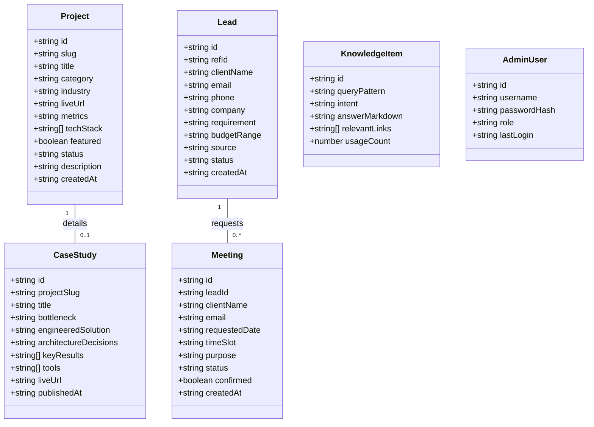

# Database & Backend Inventory: DevrajSinghTomar.com

**Inventory Date:** November 2026  
**Auditor:** Antigravity AI Assistant  
**Database Audit Verdict:** **ZERO EXISTING DATABASE INFRASTRUCTURE.** The current production application operates 100% as a stateless, static frontend.

---

## 1. Forensic Inspection of Current Backend Systems

### 1.1 Database Connection (MongoDB / SQL / ORM)
- **Status:** **NOT FOUND (0%).**
- **Dependency Search:** A thorough inspection of `package.json` confirms that neither `mongodb`, `mongoose`, `@prisma/client`, `drizzle-orm`, `@libsql/client`, `typeorm`, nor any other database driver or client is installed.
- **Codebase Search:** Grepping `src/` for connection strings, `connectToDatabase`, `MongoClient`, or mongoose schemas returns zero results.
- **Conclusion:** There is no existing MongoDB or SQL database running in this codebase.

### 1.2 Database Models & Schemas
- **Status:** **NOT FOUND (0%).**
- **Existing Data Representation:** Data currently exists strictly as in-memory, hardcoded TypeScript arrays:
  - **Articles:** `src/app/blog/data.ts` (`blogPosts: BlogPost[]`)
  - **Projects & Clients:** `src/components/CaseStudiesClient.tsx` (`webProjects[]`, `socialProjects[]`, `featuredCases[]`)
  - **Ventures:** `src/app/ventures/VenturesClient.tsx` (`ventures[]`)
  - **Contacts & Profiles:** Embedded in `layout.tsx`, `proxy.ts`, and `HomeClient.tsx`

### 1.3 Server Actions
- **Status:** **NOT FOUND (0%).**
- Searching `src/` for the `"use server"` directive yielded **0 occurrences**. Every interactive component currently relies on client-side state hooks (`"use client"`).

### 1.4 Authentication & Authorization
- **Status:** **NOT FOUND (0%).**
- There is no session provider, JWT verification, cookie parsing, or role check logic anywhere in the codebase.
- There are no admin user tables, hashed passwords, or permission matrices.

### 1.5 Image Upload & Media Management
- **Status:** **NOT FOUND (0%).**
- The project has no S3, Cloudinary, Uploadthing, Multer, or local file upload route.
- All images are statically stored in `/public/` (`devraj-singh-tomar.jpg`, `devraj-singh-tomar-mobile.jpg`, `logo-dark.png`, `logo-light.png`, `og-image.png`).

### 1.6 Contact Form & Lead Submissions
- **Status:** **MOCK CLIENT IMPLEMENTATION.**
- Current implementation in `src/app/contact/ContactClient.tsx`:
  ```typescript
  const handleSubmit = (e: React.FormEvent) => {
    e.preventDefault();
    setIsSubmitting(true);
    // Simulate sending
    setTimeout(() => {
      setIsSubmitting(false);
      alert("Message sent successfully!");
      setFormData({ name: "", email: "", message: "" });
    }, 1500);
  };
  ```
- **Consequence:** Inquiries submitted by visitors are silently discarded after the alert popup. No email is sent and no lead record is stored.

### 1.7 Existing API Routes
- **Status:** **1 ACTIVE ENDPOINT.**
- `src/app/api/mcp/route.ts`: Implements the Model Context Protocol (MCP) JSON-RPC 2.0 interface.
  - Handles `POST` requests for `initialize`, `tools/list`, and `tools/call`.
  - Tools supported: `get_portfolio_info` (returns static profile JSON) and `contact_devraj` (returns a static confirmation string without saving).
  - Handles `GET` requests returning server status.

---

## 2. Planned Data Architecture & Schema Specifications

To fulfill the requirements for the Admin CMS, Leads CRM, Meeting Scheduler, Project Estimator, and Knowledge Base **without introducing Docker or external paid database dependencies**, we define the following logical schema models. 

These will be implemented using a type-safe, embedded JSON document store or local SQLite/LibSQL database that runs natively within Node.js:



### 2.1 Schema Definitions (TypeScript & Zod)

#### 1. Project Entity (`Project`)
```typescript
interface Project {
  id: string;
  slug: string;
  name: string;
  category: "Education" | "Healthcare" | "Legal" | "Business & Services" | "Startups" | "Personal Brands";
  url: string;
  tech: string[];
  desc: string;
  featured: boolean;
  order: number;
  status: "published" | "draft" | "archived";
}
```

#### 2. Deep Case Study Entity (`CaseStudy`)
```typescript
interface CaseStudy {
  id: string;
  slug: string;
  title: string;
  url: string;
  tag: string;
  problem: string;
  solution: string;
  tools: string[];
  results: string;
  architectureDetails?: string;
  galleryImages?: string[];
  featured: boolean;
  status: "published" | "draft";
}
```

#### 3. Lead & Estimator Entity (`Lead`)
```typescript
interface Lead {
  id: string;
  refId: string; // e.g., "DST-2026-8942"
  name: string;
  email: string;
  phone?: string;
  company?: string;
  serviceCategory: string;
  selectedFeatures?: string[];
  budgetRange?: string;
  message: string;
  source: "contact_form" | "project_estimator" | "hire_page" | "mcp_agent";
  status: "new" | "contacted" | "qualified" | "closed";
  createdAt: string;
}
```

#### 4. Meeting Request Entity (`Meeting`)
```typescript
interface Meeting {
  id: string;
  leadId?: string;
  name: string;
  email: string;
  phone?: string;
  requestedDate: string;
  timeSlot: string; // e.g., "10:00 AM - 11:00 AM IST"
  purpose: "Project Consultation" | "Technical Advisory" | "Venture Partnership" | "Other";
  notes?: string;
  status: "pending_review" | "confirmed" | "declined" | "rescheduled";
  createdAt: string;
}
```

#### 5. Ask Devraj Knowledge Base Entity (`KnowledgeItem`)
```typescript
interface KnowledgeItem {
  id: string;
  keywords: string[];
  question: string;
  intent: "pricing" | "tech_stack" | "experience" | "availability" | "ventures" | "process" | "contact";
  answerMarkdown: string;
  actionLink?: {
    label: string;
    href: string;
  };
  priority: number;
}
```

#### 6. Admin User Entity (`AdminUser`)
```typescript
interface AdminUser {
  id: string;
  username: string;
  passwordHash: string; // Salted SHA-256 or bcrypt
  role: "super_admin" | "editor";
  createdAt: string;
  lastLogin?: string;
}
```

---

## 3. Storage Layer Strategy Recommendation

Because **Docker is prohibited** and the application must build cleanly as a standalone Next.js deployment:
1. **Initial Zero-Dependency Engine:** Implement a file-backed JSON document storage adapter with file locking and atomic writes in a dedicated `data/` or `storage/` directory.
2. **Database Fallback:** If a MongoDB connection string (`MONGODB_URI`) is subsequently supplied by the user in environment variables, the storage layer will automatically switch to MongoDB without requiring code modifications.
3. **Data Pre-population:** The initial database will be seeded from the existing verified data in `src/app/blog/data.ts`, `src/components/CaseStudiesClient.tsx`, and `src/app/ventures/VenturesClient.tsx` so zero existing content is lost.
