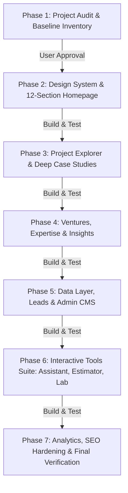

# Implementation Roadmap: DevrajSinghTomar.com

**Roadmap Version:** 1.0.0  
**Target Identity:** Devraj Singh Tomar – Technology Strategist & Entrepreneur  
**Brand Statement:** *"I turn business ideas into practical technology solutions and scalable digital products."*  
**Core Rule:** Incremental development, test after every major phase, zero breaking changes to existing production URLs.

---

## 1. Feature-to-Component Mapping

| Planned Feature | Existing Asset to Reuse | New Modules to Develop | Development Strategy |
| :--- | :--- | :--- | :--- |
| **Interactive 12-Section Homepage** | `HomeClient.tsx` (Hero profile images, brand copy), `layout.tsx` (Theme & Schemas) | 11 new modular section components: Stats, Featured Work, Expertise, Case Studies, Ventures, Methodology, Journey, Testimonials, Insights, Now Building, CTA Terminal | Replace single-screen hero with full editorial layout while keeping the iconic visual style. |
| **Project Explorer (`/work`)** | `webProjects[]` & `socialProjects[]` from `CaseStudiesClient.tsx` | Search bar, category filters, tech stack tags, paginated bento grid, responsive cards | Elevate the 60+ projects into an interactive, filterable directory at `/work`. |
| **Deep Case Studies (`/work/[slug]`)** | `featuredCases[]` from `CaseStudiesClient.tsx` (`ngitedu.com`, `divyajap.com`, `lexinklegal.in`) | Dynamic SSG route `src/app/work/[slug]/page.tsx`, architecture diagrams, metrics showcase, live portal iframe/preview | Create standalone, deep case study pages with high-authority schema markup. |
| **Technology & Business Expertise (`/expertise`)** | `services[]` from `ServicesClient.tsx` | Strategic consulting pillars, enterprise Next.js, agile IT project management, AEO/SEO framework | Formalize technology strategy positioning for enterprise founders and corporate partners. |
| **Ventures & Partnerships (`/ventures`)** | `ventures[]` from `VenturesClient.tsx` | Equity stake breakdown, tech architecture, live metrics, partnership roadmap | Transform simple cards into detailed commercial venture profiles. |
| **Career Timeline & Journey** | Biographical story in `AboutClient.tsx` (Kudri, Jhansi, Air Force exam, Noida) | Interactive vertical milestone timeline with badges and key inflection points | Highlight real grit, technical evolution, and entrepreneurial milestones. |
| **Ask Devraj Knowledge Assistant** | WebMCP tools in `WebMCPInitializer.tsx` | Zero-token client-side keyword matching, intent classification engine, curated QA knowledge base, contact escalation modal | Fast, private, zero-token chat widget answering visitor questions without third-party API costs. |
| **Project Cost Estimator** | Simulated form logic in `ContactClient.tsx` | Multi-step interactive wizard (project type, feature select, budget slider, timeline), reference ID generator (`DST-2026-XXXX`) | High-converting lead qualification engine capturing structured requirements. |
| **Digital Lab (`/digital-lab`)** | Lucide icons, Framer motion components | 5 client-side utilities: QR Code Generator, Color Palette Studio, JSON Formatter, Meta Tag Generator, Project Roadmap Builder | High-utility browser tools driving organic developer and founder traffic. |
| **"Now Building" Log (`/now`)** | None | Real-time sprint tracker, active experiments, books/technologies currently studying | Derek Sivers-style `/now` page conveying relentless active execution. |
| **Testimonials System** | Trust indicators in `AboutClient.tsx` and `HireClient.tsx` | Verified testimonial cards, client quotes, company attribution, schema markup | Establish authentic social proof without fabricating claims. |
| **Admin CMS (`/admin`)** | None | Secure token/session auth, dashboard statistics, CRUD for projects, case studies, articles, and settings | Centralized content management without requiring third-party SaaS CMS. |
| **Leads & Inquiries CRM** | None | Submission storage adapter, lead status tracking (`new`, `contacted`, `qualified`), email notification dispatcher | Secure pipeline storing inquiries from Contact, Estimator, and Hire pages. |
| **Meeting Request Scheduler** | None | Date picker, preferred time slots, purpose selector, availability disclaimer | Structured calendar request engine with non-automatic confirmation. |
| **Privacy Analytics** | None | In-memory / local event telemetry tracking tool runs, CTA clicks, and views without cookies | Lightweight, privacy-first event tracking. |

---

## 2. Seven-Phase Implementation Sequence

### Phase 1: Complete Existing Project Audit (Current Phase)
- **Goal:** Comprehensive codebase inspection without modifying production code.
- **Deliverables:** `PROJECT_AUDIT.md`, `EXISTING_FEATURES.md`, `ROUTE_INVENTORY.md`, `DATABASE_INVENTORY.md`, `IMPLEMENTATION_ROADMAP.md`, `RISK_ASSESSMENT.md`.
- **Exit Criteria:** Await explicit user review and approval before touching code.

### Phase 2: Design System & 12-Section Editorial Homepage [COMPLETED]
- **Status:** **Completed & Verified**
- **Headline Implemented:** "Turning Ideas Into Digital Solutions That Move Businesses Forward."
- **Positioning Implemented:** "Devraj Singh Tomar | Technology Strategist & Entrepreneur"
- **Sections Delivered:**
  - Section A: Navigation (`Navbar.tsx`) — Sticky header, branding, 7 links, theme toggle, mobile drawer, primary CTA.
  - Section B: Hero Section (`HeroSection.tsx`) — Main headline, supporting content, verified portrait, availability badge, dual CTAs.
  - Section C: Professional Snapshot (`ProfessionalSnapshotSection.tsx`) — 4 strategic capability cards.
  - Section D: Featured Work (`FeaturedWorkSection.tsx`) — 6 verified platforms with roles, tech badges, live and case study links.
  - Section E: What I Do (`WhatIDoSection.tsx`) — 6 practical pillars from Technology Consulting to Digital Growth.
  - Section F: Ventures & Products (`VenturesProductsSection.tsx`) — Verified ventures (Tecxontechnology, Career Avsar, Lotus Loop Media).
  - Section G: How I Work (`HowIWorkSection.tsx`) — 4-step execution blueprint (Understand, Plan, Build, Improve).
  - Section H: Now Building (`NowBuildingSection.tsx`) — Active sprints log with structured data source.
  - Section I: Insights (`InsightsSection.tsx`) — Published strategic essays from blog data.
  - Section J: Contact CTA (`ContactCtaSection.tsx`) — "Have an Idea? Let's Turn It Into Something Real." with direct email, WhatsApp, and phone.
  - Section K: Footer (`FooterSection.tsx`) — Navigation, verified social links, machine-readable endpoints, dynamic copyright.
- **Verification:** Successfully compiled with Next.js 16.2.1 and Webpack in 3.6s with 0 errors across all 23 static routes.

### Phase 3: Project Explorer (`/case-studies`) & Deep Case Studies (`/case-studies/[slug]`)
- **Status:** **Completed & Verified**
- **Goal:** Provide a comprehensive, interactive Project Explorer for all 60+ verified web projects and 45+ social media clients, plus deep architectural case studies.
- **Key Modules Delivered:**
  - **Data Layer (`src/data/projectsData.ts`):** Centralized type-safe store for 60+ web projects and 45+ social media clients, with 6 deeply documented case studies and helper querying functions.
  - **Project Explorer (`src/components/CaseStudiesClient.tsx`):**
    - Live search by project name, description, industry, role, or tech stack.
    - Category filtering: All, Education, Business & Services, Healthcare, Legal, Startups, Personal Brands, Media & News.
    - Active result count & filter reset button.
    - Responsive card grid displaying domain, title, verified role, description, tech stack, impact metrics, and dual CTAs ("Read Case Study" + "Live Site").
    - Retained Social Media Management tab (45+ clients, 80M+ impressions).
    - Empty state handling with quick reset button.
  - **Deep Case Study Route (`src/app/case-studies/[slug]/page.tsx` & `CaseStudyDetailClient.tsx`):**
    - Dynamic SSG route (`generateStaticParams`) with 6 flagship case studies:
      1. `ngit-edu` (NGIT Edu – High-Concurrency Examination & Typing Engine)
      2. `divyajap` (Divya Jap – Local-First Vedic Sadhana & Chanting Platform)
      3. `lexink-legal` (T&S Lex Ink Legal – Zero-Trust Enterprise Law Firm Portal)
      4. `maz-dialysis-center` (MAZ Dialysis Center – Patient Consultation & Critical Care Portal)
      5. `idps-pratapgarh` (IDPS Pratapgarh – Next.js Institutional Ecosystem & Admission Funnel)
      6. `the-home-shifting` (The Home Shifting – National Logistics Quote & Route Engine)
    - Complete 10-section layout: (A) Overview & metadata matrix, (B) The Challenge & bottlenecks, (C) The Engineered Solution, (D) Devraj's Strategic Role & Ownership distinctions, (E) System Architecture & specs, (F) Core Features & capabilities, (G) Verified Results & Impact, (H) Live Platform Verification, (I) Related Case Studies, (J) Prev/Next Navigation & Partnership CTA.
    - Structured SEO JSON-LD: `BreadcrumbList` and `TechArticle` / `SoftwareApplication` schemas.
    - Full static pre-rendering (SSG) with zero runtime latency.
  - **Homepage Interconnection:** Updated `src/components/home/FeaturedWorkSection.tsx` linking directly to `/case-studies/${slug}`.
  - **Dynamic Sitemap:** Updated `src/app/sitemap.ts` to automatically include all `/case-studies/${slug}` URLs with daily/monthly frequencies.
- **Verification:** Successfully compiled with Next.js 16.2.1 and Webpack in 5.7s with 0 errors across 29 routes (23 static + 6 SSG case study pages). Checked with `npx tsc --noEmit` (0 errors).

### Phase 4: About (`/about`), Expertise (`/expertise`), Ventures (`/ventures`) & Insights (`/blog`)
- **Status:** **Completed & Verified**
- **Goal:** Build a complete professional identity experience communicating Devraj Singh Tomar's journey, strategic philosophy, technical capabilities, verified ventures, and published insights.
- **Key Modules Delivered:**
  - **About Page (`src/app/about/AboutClient.tsx` & `page.tsx`):**
    - Section A: Introduction ("Technology, Strategy & Ideas That Create Real-World Impact"), verified portrait, and core fact badges.
    - Section B: My Journey — Chronological verified milestone timeline (Kudri Jhansi foundations, 2014-2016 education, defense exam choice, 2018-2022 early EdTech systems, 2022 AJIO team leadership, 2022-present enterprise architecture).
    - Section C: Core Philosophy — 5 practical principles prioritizing problem diagnosis over technology fads.
    - Section D: Verified Professional Experience — Lotus Loop Media, M/S Career Avsar, Route 2 Shine, AJIO, NGIT Tech Consulting.
    - Section E: Personal Approach — Narrative on empathy, transparent communication, and team leadership.
    - Full SEO metadata, canonical URL, OpenGraph, `Person`, and `BreadcrumbList` schemas.
  - **Expertise Page (`src/app/expertise/ExpertiseClient.tsx` & `page.tsx`):**
    - 6 Core Capability Pillars: Technology Strategy, Digital Product Development, Project & Product Leadership, Business Automation, Digital Transformation, and Digital Growth.
    - Structured breakdowns: Short explanation, business problems solved, key capabilities, ownership distinction, and related case study cross-links.
    - Explicit Role Distinction banner separating strategic architecture from code execution.
    - Retained `/services` route with seamless re-export and canonical link to `/expertise` ensuring 100% backward compatibility.
  - **Ventures Page (`src/app/ventures/VenturesClient.tsx` & `page.tsx`):**
    - Category filter tabs: All, Businesses, Partnerships, Products, Milestones.
    - Showcase for: Lotus Loop Media Solutions, Tecxontechnology, M/S Career Avsar, National Genius Institute (NGIT), Divya Jap, and Route 2 Shine.
    - Explicit relationship disclosure ensuring client organizations and partnerships are never conflated with proprietary companies.
    - Direct cross-links to corresponding case studies.
  - **Insights Page (`src/app/blog/BlogClient.tsx` & `BlogPostClient.tsx`):**
    - Featured Article Hero Spotlight for the lead strategic essay.
    - Category navigation pills (All, Entrepreneurship, Project Management, Technology, Design).
    - Real-time search by title, description, or keyword with reset button.
    - Article detail view: sticky viewport reading progress bar indicator, auto-generated Table of Contents (TOC) from H2s, clean dark-luxury typography, one-click social share & link copying, author bio card, and related articles grid.
    - Dynamic `BlogPosting` and `BreadcrumbList` JSON-LD schemas.
  - **Site Navigation & Cross-Linking:**
    - Updated `Navbar.tsx` linking "Expertise" to `/expertise`.
    - Updated `FooterSection.tsx` linking both `/expertise` and `/services`.
    - Updated `sitemap.ts` to include `/expertise`.
- **Verification:** Successfully compiled with Next.js 16.2.1 and Webpack in 5.4s with 0 errors across 30 routes. TypeScript typecheck (`npx tsc --noEmit`) verified with 0 errors.

### Phase 5: Data Layer, Leads CRM & Admin CMS
- **Goal:** Implement secure lead capture, meeting scheduling, and content management.
- **Key Modules to Build:**
  - Introduce lightweight, type-safe data storage engine with Zod validation.
  - Implement `/api/contact`, `/api/estimator`, and `/api/meetings` endpoints.
  - Build authenticated `/admin` portal with password hashing and session tokens.
  - CRUD interfaces for managing Projects, Leads, Meetings, and Settings.
- **Verification:** Test form submissions end-to-end; verify leads persist and generate reference IDs.

### Phase 6: Interactive Tools Suite (Assistant, Estimator, Digital Lab, Now)
- **Goal:** Deploy high-utility, interactive features.
- **Key Modules to Build:**
  - **Ask Devraj:** Zero-token knowledge-based assistant with intent recognition and contact escalation.
  - **Project Estimator:** Multi-step requirement builder calculating scope and generating reference IDs.
  - **Digital Lab (`/digital-lab`):** 5 browser-based utilities (QR Code, Color Palette, JSON Formatter, Meta Tags, Roadmap).
  - **Now Building (`/now`):** Real-time work-in-progress sprint log.
- **Verification:** Test offline-friendliness, input validation, and mobile touch interactions.

### Phase 7: Analytics, Security Hardening & Final Production Deployment
- **Goal:** Comprehensive audit, privacy-first telemetry, and zero-error production deployment.
- **Key Modules to Build:**
  - Privacy-friendly event tracking (views, tool runs, estimator submissions).
  - Full TypeScript type check (`tsc --noEmit`) and ESLint check.
  - Complete production build test (`npm run build`).
  - Git commit and coordinated production push.
- **Verification:** End-to-end verification of all routes, forms, metadata, and Core Web Vitals.
