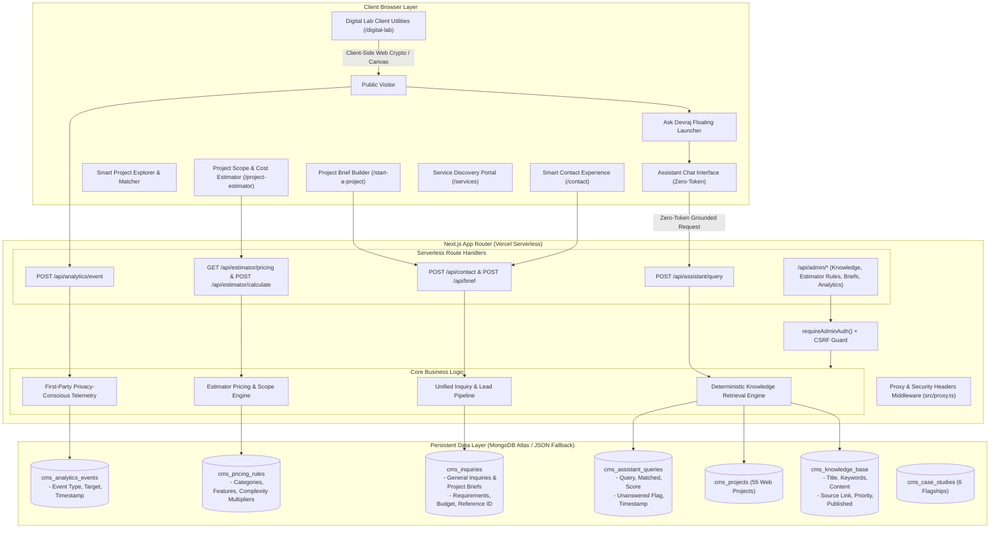
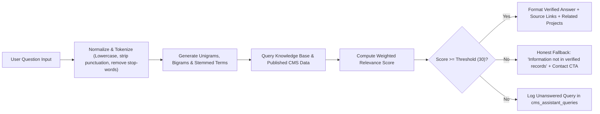

# Phase 6 System Architecture: Interactive Intelligence & Lead Generation Platform

**Project:** DevrajSinghTomar.com  
**Target Identity:** Devraj Singh Tomar | Technology Strategist & Entrepreneur  
**Architecture Version:** 1.0.0  

---

## 1. System Architecture Diagram

---

## 2. "Ask Devraj" Zero-Token Knowledge Engine

### 2.1 Design Philosophy & Zero-Token Compliance
Rather than relying on third-party generative LLMs (OpenAI, Anthropic, Gemini) that incur monthly inference costs, introduce latency, and risk hallucinating client claims, **Ask Devraj v1** uses a **deterministic, weighted knowledge retrieval engine**.
- It is 100% free of external API token costs.
- It is sub-millisecond fast (response time < 20ms).
- It never invents credentials, clients, or revenue figures.
- It returns strictly grounded responses paired with verified internal platform links.

### 2.2 Matching & Ranking Algorithm

#### Scoring Weights
- **Exact Keyword Match in Topic / Title:** +15 points.
- **Match in Target Questions / Aliases:** +12 points.
- **Match in Tags / Technology Badges:** +8 points.
- **Match in Summary / Description:** +5 points.
- **Match in Full Content / Paragraphs:** +2 points.
- **Minimum Confidence Threshold:** 30 points required to deliver a direct match. Below 30 points, the assistant provides an honest fallback and suggests connecting with Devraj directly via WhatsApp or Contact Form.

### 2.3 Assistant Client Interface
- **Floating Launcher:** Non-intrusive floating pill on bottom-right of all public pages with an animated beacon.
- **Expandable Drawer:** Polished modal dialog with header, quick-suggestion prompt pills, message stream, typing indicator simulation, and source reference cards.
- **Mobile Ergonomics:** Smooth full-screen drawer on mobile screens with close button positioned away from mobile navigation elements.
- **Session History:** In-memory session chat history with clear-conversation option.

---

## 3. Smart Project Explorer & Matching Engine

### 3.1 Multi-Dimensional Filtering
Existing projects in `data/cms/projects.json` (55 web projects, 6 deep case studies, 45 social media clients) are categorized across:
- **Category:** Education, Business & Services, Healthcare, Legal, Startups, Personal Brands, Media & News.
- **Industry:** EdTech, Legal Tech, HealthTech, Logistics, E-Commerce, Hospitality, Professional Services.
- **Tech Stack:** Next.js, React, Node.js, TypeScript, Tailwind CSS, MongoDB, WebSockets, PHP/MySQL, PWA, Web Haptics.
- **Verification Status:** Live in Production, Flagship Case Study Available.

### 3.2 "Find My Solution" Matcher
An interactive selector allows visitors to specify:
1. "I am looking for a..." [School / Coaching Portal, Legal Firm System, Healthcare Admission Engine, E-Commerce Store, High-Concurrency Web App].
2. "My primary challenge is..." [Speed & Uptime, SEO & Google Rankings, Zero-Trust Security, Conversion Funnels, Custom Workflows].
The matcher ranks verified CMS projects solving that exact problem and highlights the relevant case study.

---

## 4. Project Estimator Engine (`/project-estimator`)

### 4.1 Centralized Pricing Configuration
Pricing rules are managed strictly in `CmsEstimatorRule` (stored in `cms_pricing_rules` in MongoDB or `data/cms/pricing_rules.json` locally):
- **Base Categories:**
  - Standard Business Platform (Base: ₹25,000 – ₹45,000 / $350 – $600)
  - Institutional & School Portal (Base: ₹35,000 – ₹65,000 / $500 – $850)
  - Healthcare & Clinic Management (Base: ₹45,000 – ₹85,000 / $600 – $1,100)
  - Legal Enterprise Firm Portal (Base: ₹40,000 – ₹75,000 / $550 – $1,000)
  - Custom Web Application / SaaS (Base: ₹75,000 – ₹1,80,000 / $1,000 – $2,400)
  - E-Commerce & Catalog System (Base: ₹40,000 – ₹90,000 / $550 – $1,200)
- **Feature Modifiers:**
  - User Authentication & Role-Based Access: +₹10,000 – ₹18,000
  - Custom Admin CMS: +₹15,000 – ₹25,000
  - Payment Gateway & Invoice Engine: +₹8,000 – ₹15,000
  - Real-Time WhatsApp / Notification Automation: +₹6,000 – ₹12,000
  - Advanced Technical SEO & Schema Automation: +₹10,000 – ₹20,000
  - Sub-Millisecond Speed & Edge Optimization: +₹12,000 – ₹22,000
- **Complexity Multipliers:**
  - Basic: 1.0x
  - Standard: 1.25x
  - Advanced: 1.6x
  - Enterprise Custom: 2.2x
- **Delivery Timeline Modifiers:**
  - Standard (4-6 weeks): 1.0x
  - Accelerated Sprint (2-3 weeks): 1.25x
- **Disclaimer Banner:** Explicitly states: *"Estimates generated are indicative guidelines to assist in project scoping. Formal commercial quotations are provided following a technical discovery session."*

---

## 5. Project Brief Builder (`/start-a-project`)

A structured 9-step guided intake wizard that funnels potential clients into qualified inquiries:
1. **Project Archetype:** Web Platform, Mobile PWA, Enterprise Portal, Custom Automation.
2. **Organization Context:** Business name, current stage (Idea, Established, Scale-up).
3. **Core Problem Statement:** Pain points and intended user workflow.
4. **Required Capabilities:** Checklist of technical features.
5. **Reference Benchmarks:** Competitors or inspirational websites.
6. **Timeline Target:** Delivery urgency.
7. **Budget Range:** Planned capital investment.
8. **Contact & Stakeholder Details:** Name, email, telephone/WhatsApp.
9. **Submission & Reference Code:** Generates unique `INQ-2026-XXXX` reference ID and persists directly into the `cms_inquiries` database.

---

## 6. Digital Lab Browser Utilities (`/digital-lab`)

Client-side utilities designed for founders, CTOs, and developers:
1. **Cryptographic Password Generator:** Uses `window.crypto.getRandomValues` for high-entropy password creation with customizable character sets.
2. **High-Resolution QR Code Studio:** Client-side SVG/Canvas rendering of URLs and contact vCards with one-click PNG download.
3. **Copy & Text Analyzer:** Word count, character count (with/without spaces), reading time estimation, sentence counter, case converter.
4. **JSON Formatter & Validator:** Syntax highlighting, error pinpointing with line/column indicator, minify, and copy.
5. **SERP & Social Card Previewer:** Live Google Search snippet simulator and OpenGraph card preview with character length alerts.
6. **Website Launch Checklist:** Interactive 30-point pre-launch checklist (SEO, performance, legal, accessibility) with exportable progress.

---

## 7. Privacy-Conscious First-Party Telemetry

- **Endpoint:** `POST /api/analytics/event`.
- **Event Types:** `view_project`, `view_case_study`, `start_estimator`, `complete_estimator`, `submit_brief`, `submit_contact`, `open_assistant`, `query_assistant`, `use_lab_tool`, `click_whatsapp`.
- **Data Minimization:** Zero cookies, zero IP tracking, zero PII collection. Events record only the event name, timestamp, and anonymous target (e.g. `target: "ngit-edu"`).
- **Admin Dashboard:** Displays aggregate conversion rates, top requested services, and most visited case studies.
