# Phase 6 Implementation Plan: Interactive Intelligence & Lead Generation Platform

**Project:** [devrajsinghtomar.com](https://devrajsinghtomar.com/)  
**Brand Identity:** Devraj Singh Tomar | Technology Strategist & Entrepreneur  
**Document Version:** 1.0.0  
**Status:** Prepared during Phase 6A — Awaiting User Approval before Phase 6B Execution  

---

## 1. Executive Implementation Strategy

Phase 6 transforms DevrajSinghTomar.com into an interactive, high-conversion technology platform without breaking any existing features, database models, or CMS capabilities built across Phases 1 through 5.1.

### 1.1 Core Tenets
1. **Zero External Paid AI Tokens:** The "Ask Devraj" Knowledge Assistant operates exclusively on a deterministic, weighted keyword and semantic phrase retrieval engine running within the application server. Zero reliance on OpenAI, Gemini, or Claude inference APIs.
2. **Zero-Breaking Invariance:** All 55 production web projects, 6 deep case studies, 45 social media client profiles, 4 articles, 5 ventures, and 13 administrative routes remain 100% operational.
3. **Unified Persistence:** All new data models (`CmsKnowledgeItem`, `CmsAssistantQueryLog`, `CmsEstimatorRule`, `CmsInquiry` brief extensions, `CmsAnalyticsEvent`) leverage the dual-storage architecture developed in Phase 5.1 (MongoDB Atlas primary with local JSON fallback).
4. **Clean Decoupled Architecture:** Heavy interactive features (Assistant drawer, QR code canvas generator, Project Estimator wizard) are modularized and code-split using dynamic React imports to prevent client bundle inflation.

---

## 2. Granular Sub-Phase Implementation Roadmap

```mermaid
flowchart TD
    subgraph Phase6A ["Phase 6A: Audit & Architecture (COMPLETE)"]
        AuditDoc["PHASE_6_AUDIT.md"]
        ArchDoc["PHASE_6_ARCHITECTURE.md"]
        PlanDoc["PHASE_6_IMPLEMENTATION_PLAN.md"]
        RiskDoc["PHASE_6_RISK_ASSESSMENT.md"]
    end

    subgraph Phase6B ["Phase 6B: Zero-Token Knowledge Assistant"]
        RetrievalEngine["Weighted Retrieval Engine (src/lib/assistant/retrieval.ts)"]
        AssistantApi["POST /api/assistant/query"]
        AskDevrajUI["Floating Drawer UI (AskDevrajWidget.tsx)"]
        AdminAssistant["Admin Knowledge Manager (/admin/assistant)"]
    end

    subgraph Phase6C ["Phase 6C: Smart Project Explorer & Matcher"]
        ExplorerFilters["Multi-Facet Filter Expansion"]
        ProjectMatcher["Find My Solution Matcher Modal"]
    end

    subgraph Phase6D ["Phase 6D: Interactive Scope & Cost Estimator"]
        EstimatorCalc["Pricing Engine & Rules (src/lib/estimator/calculator.ts)"]
        EstimatorApi["GET /api/estimator/pricing & POST /api/estimator/calculate"]
        EstimatorPage["Interactive Estimator Portal (/project-estimator)"]
        AdminEstimator["Admin Pricing Rules Manager (/admin/estimator)"]
    end

    subgraph Phase6E ["Phase 6E: High-Conversion Brief Builder"]
        BriefWizard["9-Step Intake Wizard (/start-a-project)"]
        InquiryBridge["Unified Inquiries Pipeline (POST /api/brief)"]
    end

    subgraph Phase6F ["Phase 6F: Digital Lab Client Utilities"]
        LabPage["Digital Lab Hub (/digital-lab)"]
        Tools6["6 Client-Side Utilities (Crypto, QR, Text, JSON, SERP, Checklist)"]
    end

    subgraph Phase6G ["Phase 6G: Strategic Services Re-Alignment"]
        ServicesPortal["Outcome-Driven Services Discovery (/services)"]
        SmartContact["Smart Contact Enhancements (/contact)"]
    end

    subgraph Phase6H ["Phase 6H: First-Party Telemetry"]
        TelemetryClient["Zero-Cookie Telemetry (src/lib/analytics/telemetry.ts)"]
        TelemetryApi["POST /api/analytics/event"]
        AdminAnalytics["Analytics & Conversion Dashboard (/admin/analytics)"]
    end

    subgraph Phase6I ["Phase 6I: SEO, Schemas & Full Verification"]
        SchemaOrg["Schema.org Rich Snippets (FAQPage, SoftwareApp)"]
        TestSuite["Automated Regression & Smoke Test Suite"]
        GitCommit["Git Verification & Milestone Checkpoint"]
    end

    Phase6A --> Phase6B
    Phase6B --> Phase6C
    Phase6C --> Phase6D
    Phase6D --> Phase6E
    Phase6E --> Phase6F
    Phase6F --> Phase6G
    Phase6G --> Phase6H
    Phase6H --> Phase6I
```

---

## 3. Sub-Phase Execution Specifications

### Phase 6A: Pre-Implementation Audit & Architecture (Current Phase)
- **Objective:** Establish verified baseline, document data inventory, design system architecture, formulate implementation roadmap, and analyze technical/business risks.
- **Deliverables:**
  1. `PHASE_6_AUDIT.md` (Completed).
  2. `PHASE_6_ARCHITECTURE.md` (Completed).
  3. `PHASE_6_IMPLEMENTATION_PLAN.md` (This document).
  4. `PHASE_6_RISK_ASSESSMENT.md` (In progress).
- **Gate:** STOP and obtain explicit user approval before proceeding to Phase 6B.

---

### Phase 6B: Zero-Token "Ask Devraj" Knowledge Retrieval Assistant
- **Objective:** Provide instant, authoritative answers to visitor questions regarding Devraj's background, ventures, technical skills, project portfolio, and engagement terms with 0% external token consumption and 0% risk of hallucination.
- **Components to Implement:**
  1. **Data Types (`src/lib/cms/types.ts`):**
     - `CmsKnowledgeItem`: `id`, `topic`, `title`, `aliases` (alternative questions), `tags`, `summary`, `content`, `sourceLink`, `relatedProjectSlugs`, `priority`, `published`, `lastUpdated`.
     - `CmsAssistantQueryLog`: `id`, `query`, `normalizedTokens`, `matchedTopicId`, `confidenceScore`, `answered`, `timestamp`.
  2. **Storage Layer (`src/lib/cms/store.ts` & `src/lib/cms/mongoStore.ts`):**
     - `getKnowledgeBase()`, `saveKnowledgeItem()`, `deleteKnowledgeItem()`.
     - `logAssistantQuery()`, `getAssistantQueryLogs()`.
     - Pre-seed 25+ comprehensive knowledge items covering biography, Kudri roots, Tecxontechnology, Career Avsar, Lotus Loop, NGIT, Divya Jap, 55 web projects, pricing guidelines, tech stacks, and consulting models.
  3. **Retrieval Engine (`src/lib/assistant/retrieval.ts`):**
     - Text normalizer: lowercase, strip punctuation, strip common English stop-words, simple suffix stemming.
     - Weighted scoring:
       - Exact match in Topic / Title: +15
       - Match in Question Aliases: +12
       - Match in Tags: +8
       - Match in Summary: +5
       - Match in Body Text: +2
     - Threshold: If score $\ge$ 30, return matched record with related project links. If score < 30, return honest fallback ("I don't have verified records on this specific question yet. You can connect with Devraj directly via WhatsApp or the contact form.") and log query for administrative review.
  4. **API Endpoint (`src/app/api/assistant/query/route.ts`):**
     - `POST` endpoint accepting `{ query: string, sessionId?: string }`.
     - Rate-limited (20 requests per IP per minute via in-memory sliding window).
     - Response includes: `{ answer: string, sources: Array<{ title: string, url: string }>, confidence: number, suggestions: string[] }`.
  5. **Client UI Component (`src/components/assistant/AskDevrajWidget.tsx`):**
     - Floating bottom-right trigger badge with pulsing status indicator ("Ask Devraj").
     - Expandable chat drawer with header ("Devraj Knowledge Assistant • Verified Offline Engine").
     - 4 starter question pills: "What is your background?", "Tell me about NGIT Edu", "What are your core tech skills?", "How do we collaborate?".
     - Message stream with simulated typing cadence (~150ms for realistic fluidity).
     - Source link cards linking directly to case studies or about sections.
     - Fallback CTA: "Message Devraj on WhatsApp" direct button.
     - Keyboard accessible (`Esc` to close, `Enter` to send).
  6. **Admin Knowledge Base Manager (`src/app/admin/assistant/page.tsx`):**
     - Add, edit, toggle publication, and delete knowledge base items.
     - In-page query tester to preview retrieval score and matched record in real time.
     - Log viewer displaying recent queries and unanswered visitor prompts.

---

### Phase 6C: Smart Project Explorer & Dynamic Project Matcher
- **Objective:** Empower prospective clients, hiring managers, and partners to quickly discover relevant projects and case studies from the 55 web projects and 6 flagship case studies.
- **Components to Implement:**
  1. **Enhanced Project Explorer Filters (`src/components/CaseStudiesClient.tsx`):**
     - Multi-facet filters: Industry (EdTech, Legal, HealthTech, Logistics, E-Commerce, Services), Role (CTO Advisory, Full-Stack Architecture, Digital Strategy), Tech Stack (Next.js, React, Node.js, TypeScript, Tailwind, MongoDB), and Type (Flagship Case Studies vs All Production Platforms).
     - Live search bar filtering on title, client name, problem solved, and technology badges.
  2. **"Find My Solution" Project Matcher Modal (`src/components/projects/SolutionMatcher.tsx`):**
     - 2-step interactive guided selector:
       - Step 1: Select your industry / sector.
       - Step 2: Select your primary technical bottleneck (High concurrency, SEO visibility, secure workflows, custom automation, modern redesign).
     - Result: Instant spotlight of the 2-3 most relevant verified production projects with problem/solution summaries and direct links.

---

### Phase 6D: Interactive Project Budget & Scope Estimator
- **Objective:** Give prospective clients transparent, realistic project scope guidelines and non-binding cost estimations, reducing scoping friction and capturing qualified leads.
- **Components to Implement:**
  1. **Data Types & Store (`src/lib/cms/types.ts` & `store.ts`):**
     - `CmsEstimatorRule`: Categories, base price ranges (INR & USD), feature add-on rates, complexity multipliers (1.0x to 2.2x), timeline sprint multipliers.
     - Default rules configured for 6 categories (Business Web Platform, School & Academic Portal, Healthcare/Clinic System, Legal Firm Enterprise, Custom SaaS/Web App, E-Commerce).
  2. **Calculation Utility (`src/lib/estimator/calculator.ts`):**
     - Pure functional deterministic calculation:
       $$\text{Base} + \sum \text{Features} \times \text{ComplexityMultiplier} \times \text{TimelineMultiplier}$$
     - Returns low and high range estimates in INR (₹) and USD ($).
  3. **Public Estimator Route (`src/app/project-estimator/page.tsx` & `ProjectEstimatorClient.tsx`):**
     - 5-step interactive wizard:
       1. Project Archetype & Base Scope.
       2. Key Technical Features (Auth, Custom CMS, Payments, WhatsApp automation, Advanced SEO).
       3. Scale & Complexity Tier (MVP, Production Standard, Enterprise Scale).
       4. Desired Timeline (Standard 4-6 weeks, Accelerated Sprint 2-3 weeks).
       5. Summary & Cost Range Projection.
     - Currency toggle (INR / USD).
     - Prominent non-binding disclaimer.
     - Action CTAs: "Transfer to Brief Builder" (pre-populates `/start-a-project`) and "Email Me This Estimate".
  4. **Admin Estimator Manager (`src/app/admin/estimator/page.tsx`):**
     - Allows updating base category prices, feature increments, and multipliers without modifying source code.

---

### Phase 6E: High-Conversion Interactive Project Brief Builder
- **Objective:** Provide a structured, frictionless proposal intake mechanism that collects actionable business requirements and converts serious visitors into high-priority inquiries.
- **Components to Implement:**
  1. **Public Intake Route (`src/app/start-a-project/page.tsx` & `BriefBuilderClient.tsx`):**
     - 9-step guided intake wizard:
       1. Project Archetype (Web App, Enterprise Portal, SaaS MVP, System Modernization).
       2. Organization Details (Company Name, Current Stage, Industry).
       3. Core Business Objectives & Bottlenecks.
       4. Scope Checklist & Technical Integrations.
       5. Existing Infrastructure & Competitor Benchmarks.
       6. Timeline & Launch Target.
       7. Budget Allocation Tier.
       8. Primary Stakeholder Contact (Name, Email, Phone/WhatsApp).
       9. Review & Final Submission.
     - Pre-fill parameter support: Automatically ingests data if redirected from `/project-estimator` or `/services`.
  2. **API Endpoint (`src/app/api/brief/route.ts`):**
     - Validates payload using structured schema.
     - Generates unique reference code: `INQ-2026-XXXX`.
     - Persists directly into `cms_inquiries` collection with `source: "brief_builder"`.
     - Triggers admin notification email if email service is active.
  3. **Admin Inquiries Enhancement (`src/app/admin/inquiries/page.tsx`):**
     - Filter between "General Contact Inquiries" and "Structured Project Briefs".
     - Expanded brief detail modal viewing comprehensive requirements, scope checklist, and budget projections.

---

### Phase 6F: Digital Lab & Interactive Technical Resources
- **Objective:** Offer practical, browser-executable tools for founders, developers, and tech executives, driving recurring traffic, organic backlinks, and practical utility.
- **Components to Implement:**
  1. **Digital Lab Route (`src/app/digital-lab/page.tsx` & `DigitalLabClient.tsx`):**
     - Clean, fast dashboard presenting 6 browser-based client-side tools:
       - **Tool 1: High-Entropy Cryptographic Password & Token Generator:** Generates secure passwords and API tokens using `window.crypto.getRandomValues`. Zero server transit.
       - **Tool 2: Vector & Canvas QR Code Studio:** Client-side generation of QR codes for URLs, WiFi credentials, and vCards with instant SVG and PNG download.
       - **Tool 3: Editorial Copy & Metrics Analyzer:** Real-time word count, character count, estimated reading duration, sentence count, and text case transformations.
       - **Tool 4: JSON Formatter, Minifier & Schema Validator:** Formats, validates syntax, identifies error line/column, and minifies JSON payloads client-side.
       - **Tool 5: SERP & Social Card Simulator:** Live preview of Google search snippets, OpenGraph cards, and Twitter/X summary cards with character truncation alerts.
       - **Tool 6: 30-Point Production Launch Checklist:** Interactive checklist covering security headers, performance, SEO, DNS, and responsive audits with progress tracking stored in `localStorage`.
  2. **Client-Side Isolation:** All utilities operate 100% inside the user's browser, consuming zero server compute and guaranteeing complete data privacy.

---

### Phase 6G: Strategic Services Re-Alignment & Smart Contact Upgrades
- **Objective:** Modernize `/services` to be outcome-driven rather than task-oriented, mapping directly to Devraj's core positioning as a Technology Strategist & Entrepreneur.
- **Components to Implement:**
  1. **Dedicated Services Route (`src/app/services/page.tsx` & `ServicesClient.tsx`):**
     - Transition `/services` from an alias to an independent, comprehensive service architecture:
       - **Pillar 1: Technology Architecture & Fractional CTO Advisory:** High-level system design, vendor evaluation, tech stack modernization.
       - **Pillar 2: Scalable Web & SaaS Platform Engineering:** High-performance web applications built on Next.js, React, Node.js, and MongoDB.
       - **Pillar 3: Technical Due Diligence & Codebase Audits:** Pre-investment technical evaluation, security analysis, architectural risk reporting.
       - **Pillar 4: Sub-Millisecond Performance & Security Hardening:** Core Web Vitals optimization, zero-trust security postures, database query tuning.
     - Direct CTA buttons on each service card deep-linking to pre-configured briefs in `/start-a-project?service=...` and estimator tiers.
  2. **Smart Contact Enhancements (`src/components/ContactClient.tsx`):**
     - Subject categorization dropdown (Advisory, New Project, Due Diligence, Speaking/Partnership).
     - Real-time WhatsApp quick-connect button with pre-formatted greeting text.

---

### Phase 6H: First-Party Telemetry & Analytics Dashboard
- **Objective:** Gain insight into visitor engagement, feature popularity, and inquiry conversion funnels without relying on invasive third-party tracking scripts or violating user privacy.
- **Components to Implement:**
  1. **Telemetry Utility (`src/lib/analytics/telemetry.ts`):**
     - Client helper function `trackEvent(eventName, eventData)` leveraging `navigator.sendBeacon` with `fetch` fallback.
     - Privacy-first design: zero cookies, zero IP tracking, zero PII collection.
  2. **Ingestion Endpoint (`src/app/api/analytics/event/route.ts`):**
     - High-speed serverless handler storing aggregate events in `cms_analytics_events` (MongoDB Atlas or local JSON).
     - Tracked events: `page_view`, `assistant_query`, `estimator_complete`, `brief_submit`, `lab_tool_use`, `whatsapp_click`.
  3. **Admin Analytics Dashboard (`src/app/admin/analytics/page.tsx`):**
     - Metrics: Total inquiries, conversion rate, top requested project types, top assistant query topics, most popular Digital Lab tools.

---

### Phase 6I: SEO, Schemas, Accessibility, Performance & Full Regression Testing
- **Objective:** Ensure perfect technical hygiene, search engine visibility, accessibility compliance, and end-to-end regression safety across all public and administrative interfaces.
- **Activities:**
  1. **Schema.org Structured Data:** Add `FAQPage` schema for Knowledge Assistant questions, `SoftwareApplication` for Digital Lab tools, and `Service` schemas for `/services`.
  2. **Performance Audit:** Verify Lighthouse scores ($\ge$ 90 Performance, 100 Accessibility, 100 Best Practices, 100 SEO). Code-split heavy interactive modules.
  3. **Automated Test Suite:** Execute comprehensive end-to-end verification script testing:
     - Assistant retrieval scoring and fallback handling.
     - Estimator calculation accuracy across multiple tiers.
     - Brief builder submission and unique reference ID generation (`INQ-2026-XXXX`).
     - Persistent storage integrity across all models.
     - Production build pass (`next build --webpack`).
  4. **Documentation & Git Commit:** Update all audit logs, generate Phase 6 completion report, and commit changes cleanly to `main`.

---

## 4. Verification Checklists & Acceptance Criteria

| Sub-Phase | Component | Target Output | Acceptance Criteria |
| :--- | :--- | :--- | :--- |
| **6A** | Pre-Implementation Audit | 4 markdown audit documents | Complete codebase inspection, zero missing dependencies, user sign-off. |
| **6B** | "Ask Devraj" Assistant | Floating drawer & retrieval engine | Zero token spend, response time < 30ms, grounded CMS facts, honest fallback. |
| **6C** | Smart Project Explorer | Filter & Matcher modal | All 55 web projects filterable, 6 case studies highlighted, modal recommendations. |
| **6D** | Scope & Cost Estimator | `/project-estimator` | Dynamic interactive calculator, INR/USD toggle, non-binding disclaimer, admin rules. |
| **6E** | Project Brief Builder | `/start-a-project` | 9-step guided intake, pre-fill from estimator, `INQ-2026-XXXX` reference code. |
| **6F** | Digital Lab | `/digital-lab` (6 tools) | 100% client-side execution, zero server latency, instant copy/download. |
| **6G** | Services & Smart Contact | `/services` & `/contact` | Outcome-driven architecture, deep CTA routing, WhatsApp quick-connect. |
| **6H** | First-Party Telemetry | Analytics API & Admin View | Zero-cookie privacy compliance, conversion funnel visibility in `/admin/analytics`. |
| **6I** | Testing & Polish | Regression suite & build | `next build` passes with 0 errors, all 24+ routes functional, clean Git commit. |

---

## 5. Rollback & Safety Protocol

1. **State Isolation:** All new administrative routes (`/admin/assistant`, `/admin/estimator`, `/admin/analytics`) and public routes (`/project-estimator`, `/start-a-project`, `/digital-lab`) operate independently. Failure in any single module cannot prevent core portfolio pages from rendering.
2. **Dual-Store Resilience:** If MongoDB Atlas connectivity drops or is unconfigured, all Phase 6 data stores fall back instantly to `data/cms/` JSON storage.
3. **Branch Protection:** All changes will be staged cleanly and verified with `next build` before committing to Git branch `main`.

---

*Phase 6 Implementation Plan finalized and ready for review.*